# Kütüphane Otomasyon Sistemi

Kitap, üye, ödünç, iade, rezervasyon ve gecikme cezası süreçlerini yöneten web uygulaması.

**Yığın:** FastAPI + SQLAlchemy + Alembic + PostgreSQL · React + Vite + TypeScript + Tailwind +
TanStack Query + Recharts · pytest + Vitest · Docker Compose

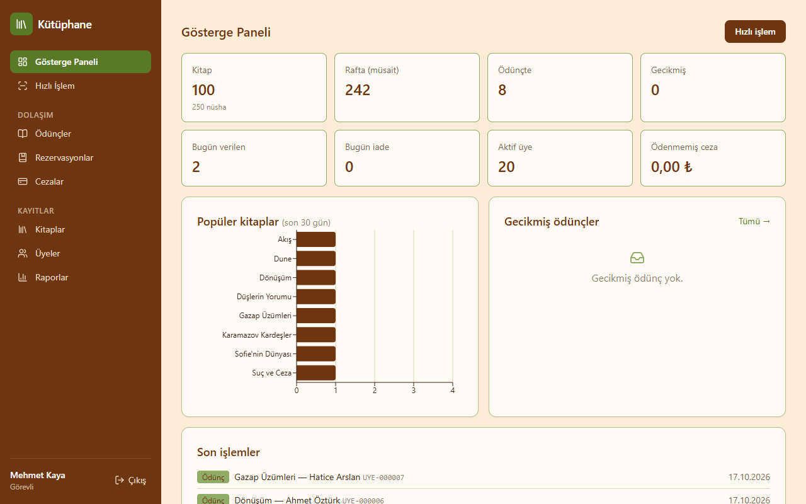

## Özellikler

- **Katalog:** kitap, yazar, yayınevi ve kategori yönetimi; nüsha ve otomatik barkod
  (`KTP-0012-01`); başlık, yazar ve ISBN araması.
- **Hızlı işlem:** üye numarası veya barkod okut; tek tıkla ödünç ver / iade al
  (barkod okuyucuyla klavye gibi çalışır).
- **Kurallar:** üye tipine göre limit, ceza ve gecikme engeli, süre uzatma, kayıp ve hasar cezası,
  rezervasyon kuyruğu. Tüm sayısal değerler yönetici ayarlarından okunur.
- **Eşzamanlılık:** aynı nüsha iki eşzamanlı istekte yalnızca bir kez verilir
  (`SELECT ... FOR UPDATE` + koşullu güncelleme).
- **Günlük görev:** gecikme, süresi dolan rezervasyon ve üyelik işlemleri.
- **Üye paneli:** katalog ve rezervasyon, ödünçlerim (süre uzatma), cezalarım, profil.
- **Raporlar:** gösterge paneli, popüler kitaplar, gecikmişler, aktif üyeler, kategori
  istatistikleri; CSV dışa aktarma.
- **Yönetim:** sistem ayarları, personel hesapları, tüm yazma işlemlerinin kaydı (audit log).

## Docker ile çalıştırma

```bash
cp .env.example .env
docker compose up --build -d
docker compose exec backend python -m app.seed   # örnek veri (yalnızca ilk kez)
```

| Servis | Adres |
|---|---|
| Arayüz | http://localhost:8080 |
| API | http://localhost:8000 (Swagger: `/docs`, sağlık: `/health`) |
| PostgreSQL | localhost:5433 (`kutuphane_db`) |

Backend konteyneri açılışta `alembic upgrade head` çalıştırır. Veritabanı Türkçe sıralamayla
(ICU `tr-TR`) oluşturulur; bu ayar yalnızca volume ilk oluşturulurken uygulanır. Değiştirmek için
volume `docker compose down -v` ile silinmelidir (veriler gider). Üretimde `.env` içindeki
`JWT_SECRET` ve veritabanı şifresi mutlaka değiştirilmelidir.

## Varsayılan giriş bilgileri (seed)

Yalnızca geliştirme içindir.

| Rol | E-posta | Şifre |
|---|---|---|
| Yönetici | admin@kutuphane.local | Admin123! |
| Görevli | gorevli1@kutuphane.local, gorevli2@kutuphane.local | Gorevli123! |
| Üye | ayse.yilmaz@kutuphane.local (ve diğer 19 üye, `ad.soyad@kutuphane.local`) | Uye12345! |

## Ekran görüntüleri

| | |
|---|---|
| 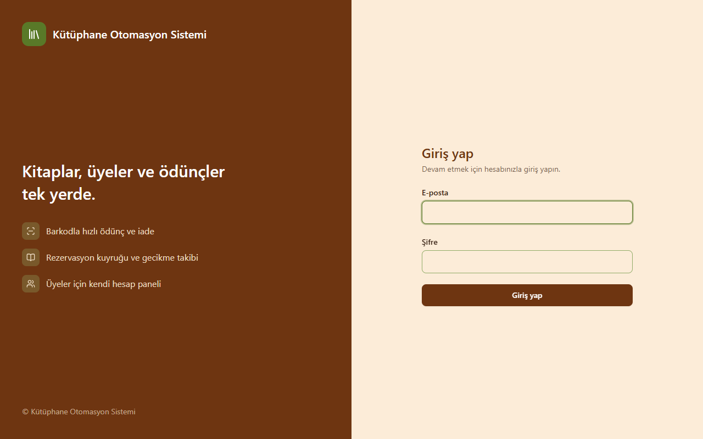 Giriş | 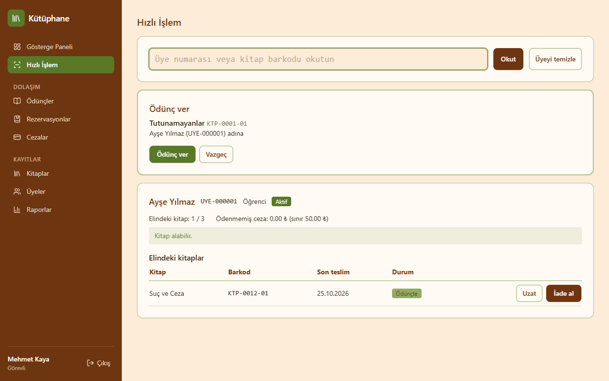 Hızlı işlem |
| 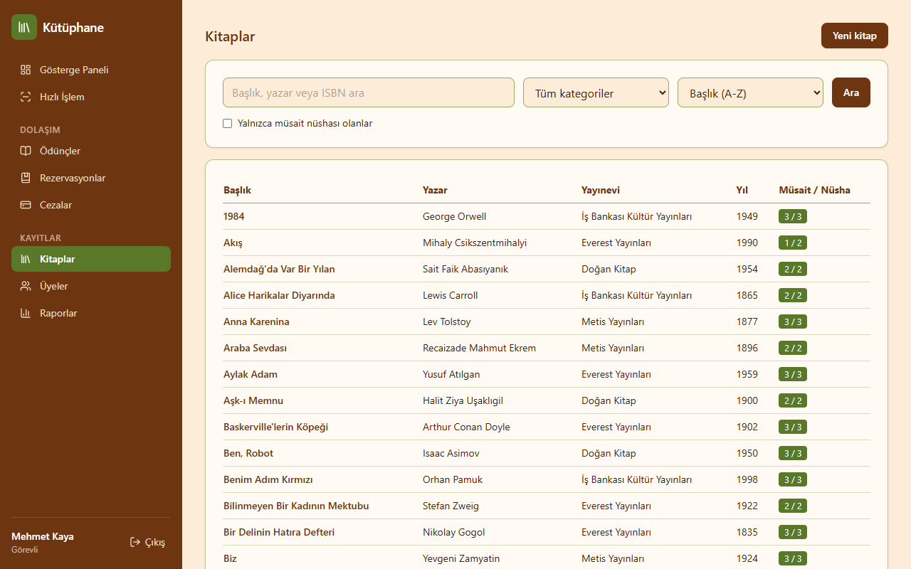 Kitaplar | 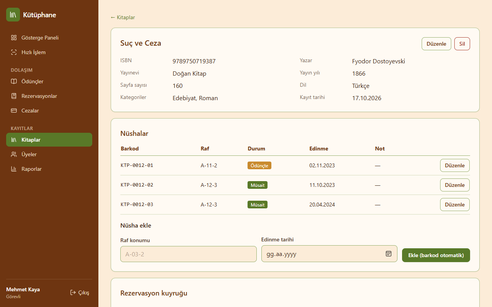 Kitap detayı ve nüshalar |
| 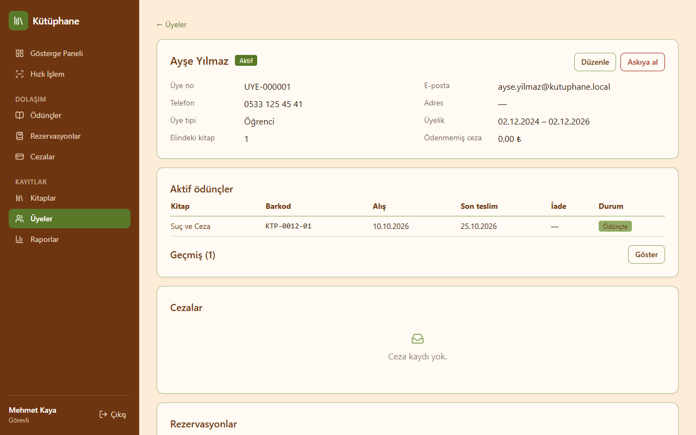 Üye detayı | 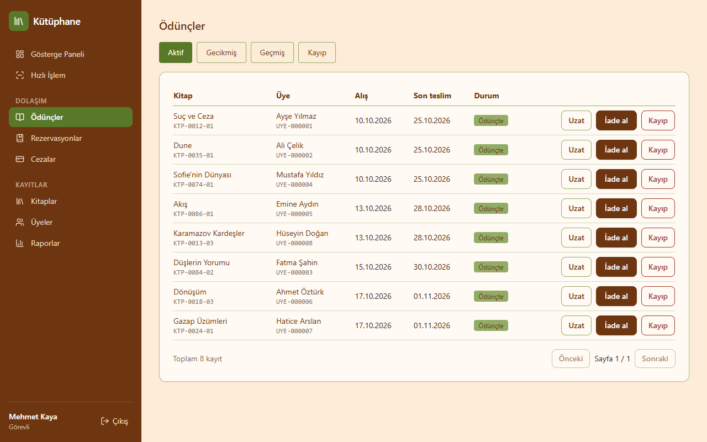 Ödünçler |
| 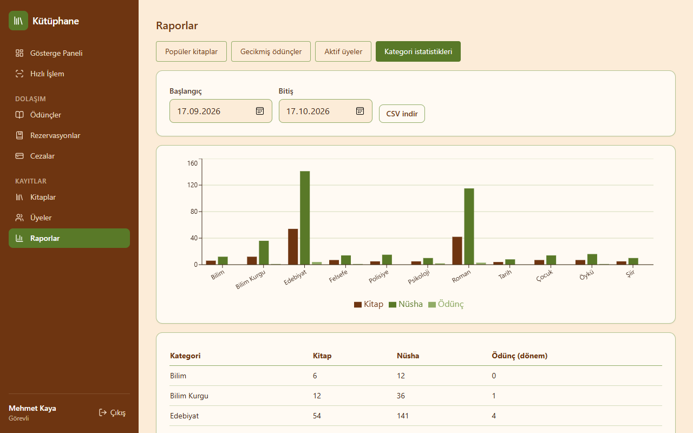 Raporlar | 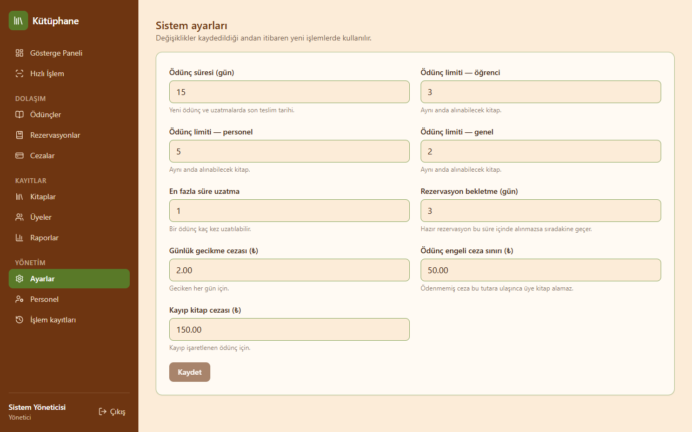 Sistem ayarları |
| 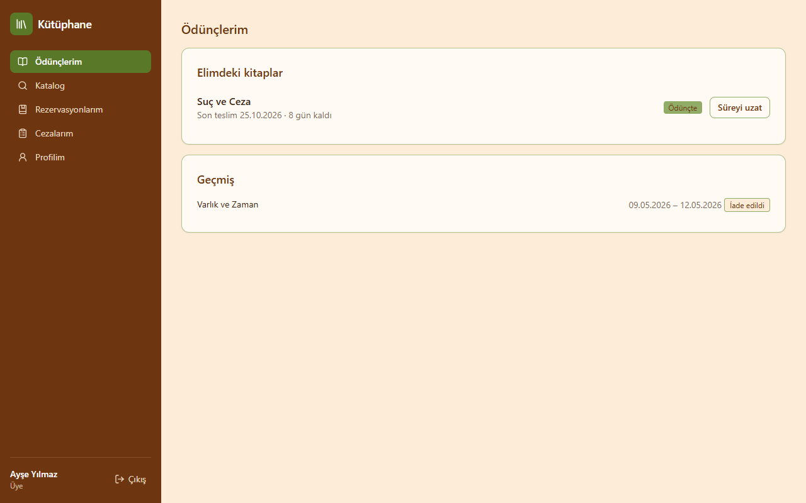 Üye paneli: ödünçlerim | 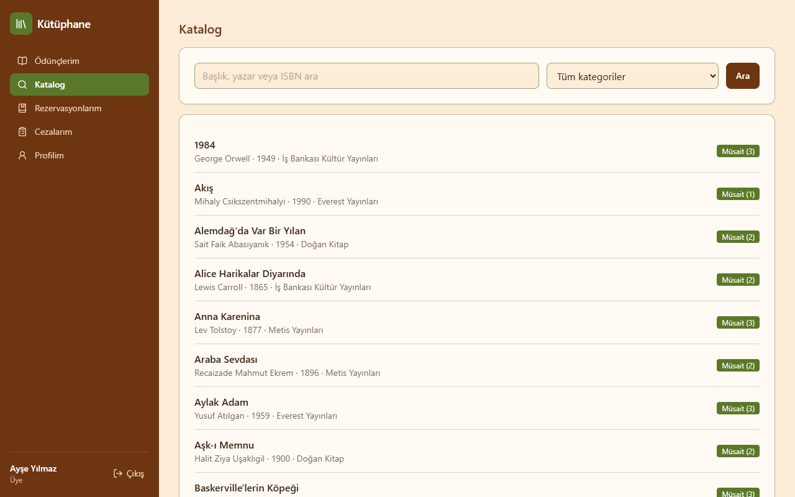 Üye paneli: katalog |


## Yerel geliştirme

### Backend (Python 3.12)

```bash
cd backend
python -m venv .venv
.venv/Scripts/activate        # Linux/macOS: source .venv/bin/activate
pip install -e ".[dev]"
alembic upgrade head          # şemayı ve varsayılan ayarları oluşturur (SQLite: kutuphane.db)
python -m app.seed            # örnek veri: 1 admin, 2 görevli, 20 üye, 100 kitap, 250 nüsha
uvicorn app.main:app --reload # http://localhost:8000
```

Test ve lint:

```bash
pytest
ruff check .
ruff format .
```

### Frontend (Node 22)

```bash
cd frontend
npm install
npm run dev                   # http://localhost:5173, /api → localhost:8000
```

Test, lint ve format:

```bash
npm test
npm run lint
npm run format
npm run build
```

## Mimari

```
backend/app/
  api/v1/        router'lar (ince katman, yalnızca servis çağırır)
  services/      iş kuralları (loan, reservation, fine, member, book, report…) — birim testli
  repositories/  sorgular
  models/        SQLAlchemy modelleri
  core/          ayarlar, güvenlik, hatalar, audit log
  jobs/          günlük görev ve zamanlayıcı
frontend/src/
  features/      books, members, loans, reservations, reports, me, admin
  components/    ortak bileşenler (yan menü, onay diyaloğu…)
```

Hatalar tek tip döner: `{"error": {"code": "LOAN_LIMIT_EXCEEDED", "message": "Üye ödünç limitine ulaştı (3/3)."}}`.
Doğrulama hatalarında alan bazlı Türkçe `details` listesi de bulunur.

